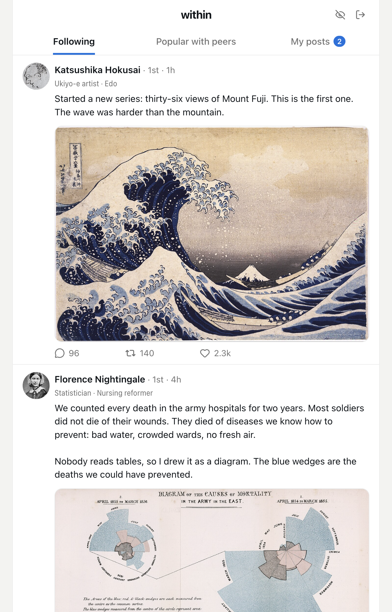
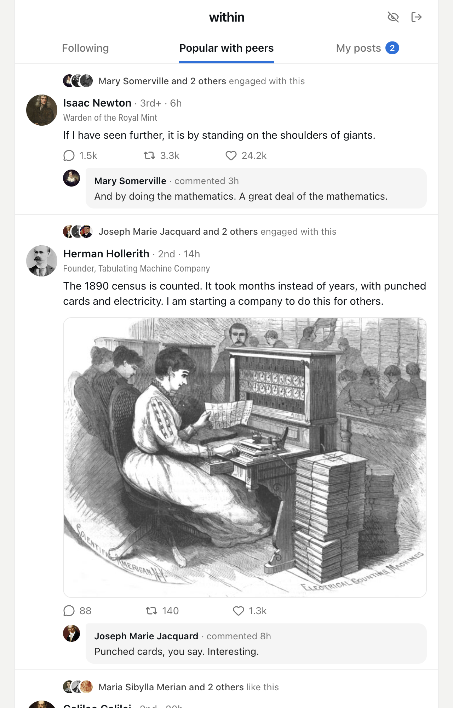
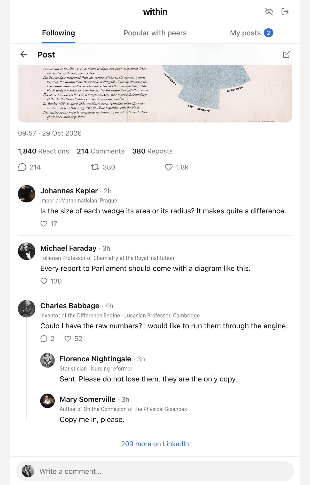
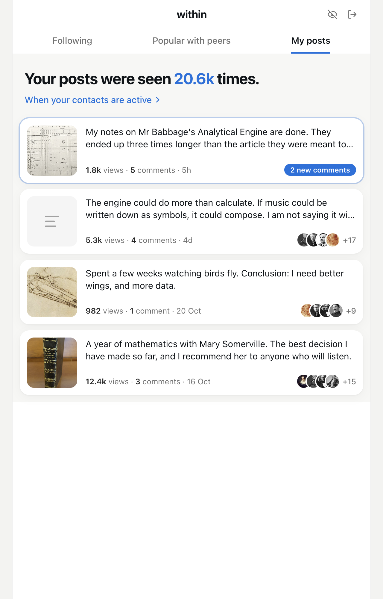

# within: a prompt, not an app

I built myself a calm LinkedIn reader: only the people I actually know, a
chronological feed of what they post, and a separate tab for what they found
worth engaging with. I am not handing out the app. Instead, here is a prompt
that describes what it does, so that a coding agent can build it for you.

## How to use it

Open [Claude Code](https://claude.com/claude-code) (or a similar coding agent)
in an empty folder and tell it:

> Clone https://github.com/fgnass/within-prompt into `./spec`, read
> `spec/PROMPT.md` and build what it describes in this folder.

The agent will ask you to sign in to LinkedIn in a window it opens. It takes a
while: let it work, and answer when it asks you something.

## What you get

The pictures below show the original, filled with made-up posts by historical
figures. Your build will look different in the details.

| | |
|---|---|
|  |  |
|  |  |

More in [`screens/`](screens). The prompt itself is [`PROMPT.md`](PROMPT.md).

## Before you start

LinkedIn has no public API for any of this. The app reads what you can see in
your own feed, with your own session, and LinkedIn's terms do not allow
automated access. Building and using it is your decision and your risk.

Portraits and pictures in the screenshots are public domain or CC0, from
Wikimedia Commons.
